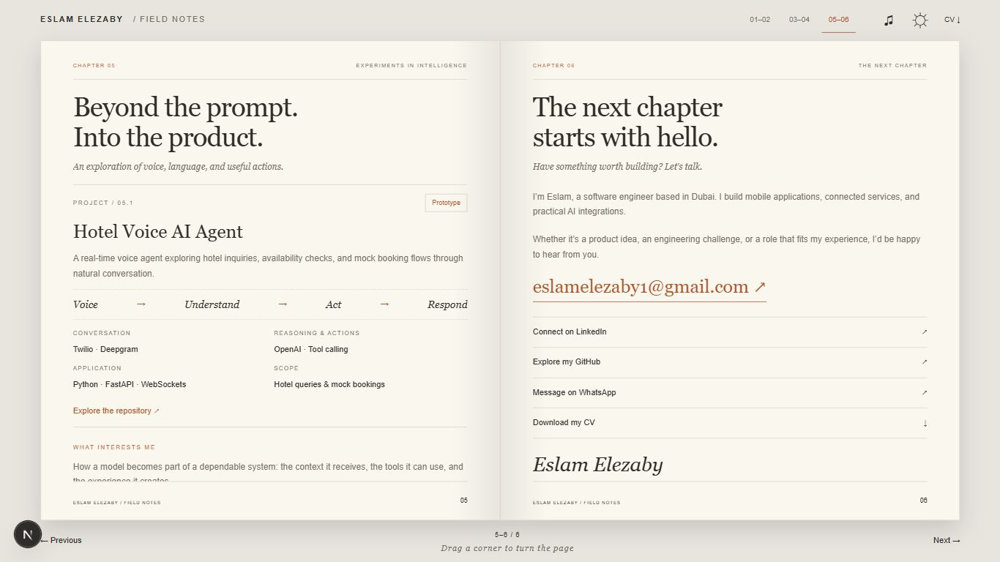
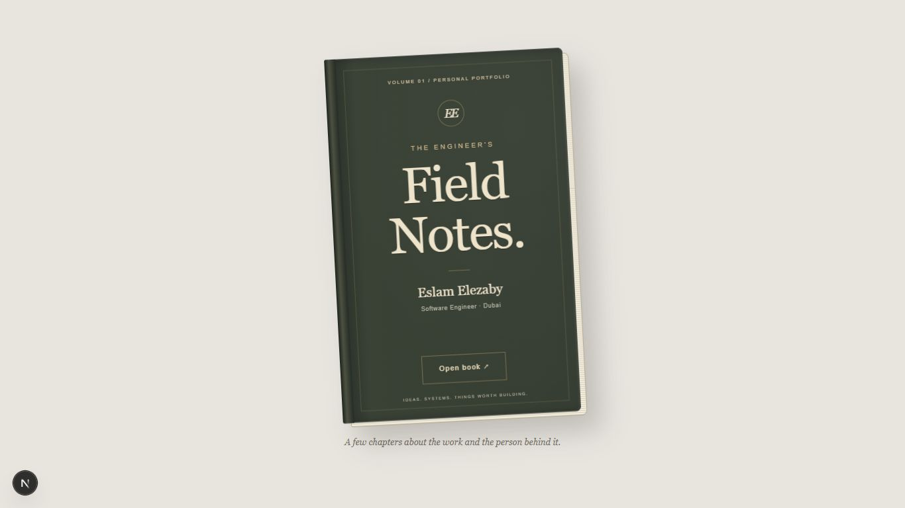
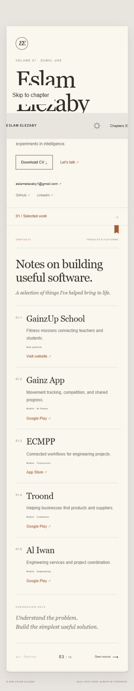

# Eslam Elezaby — The Engineer’s Field Notes

A personal portfolio presented as an open engineering notebook. Built with Next.js, TypeScript, and Tailwind CSS.

[Live website](https://eslamelezaby.vercel.app/) · [LinkedIn](https://www.linkedin.com/in/eslamelezaby98/) · [GitHub](https://github.com/eslamelezaby1)





## The experience

An ivory paper interface with editorial typography, a subtle book binding, and copper accents. Desktop shows an identity page beside the current chapter. Mobile becomes a single page with a chapter menu.

- A first-screen book cover that opens into the portfolio with paper motion and sound.
- Six chapters: about, experience, selected work, open source, AI explorations, and contact.
- Text-only product entries with direct website, App Store, and Google Play links.
- Flutter packages, a Chrome extension, and the Hotel Voice AI Agent prototype.
- A real flipbook powered by react-pageflip: draggable corners, hard covers, paper shadows, mouse-wheel navigation, and optional page-turn sound.
- Previous/next controls, arrow-key navigation, shareable chapter hashes, and browser history support.
- Day and night editions, visible keyboard focus, and reduced-motion support.
- Downloadable PDF CV served through a Next.js route handler.

## Development

Requires a supported Node.js version for the installed Next.js release.

```sh
npm ci
npm run dev
```

Open http://localhost:3000.

```sh
npm run lint
npm run typecheck
npm run build
npm start
```

## Content and structure

| File | Purpose |
| --- | --- |
| `components/notebook.tsx` | Notebook interface, chapters, and transition behavior |
| `lib/notebook.ts` | Chapter metadata, published products, and open-source links |
| `lib/portfolio.ts` | Professional profile, CV-based experience, and skills |
| `app/globals.css` | Typography, paper treatment, responsive layouts, and motion |
| `app/api/cv/route.ts` | PDF download endpoint |
| `public/Eslam-Elezaby-CV.pdf` | Current downloadable CV |

Product descriptions summarize published applications. The voice agent is presented as a prototype with mock booking flows.

## Deployment

Deploy the repository to Vercel using its Next.js preset. No application secrets or external services are required for the portfolio. Commit source files, `public`, and the lockfile; exclude `node_modules`, `.next`, and local environment files.

## Mobile


