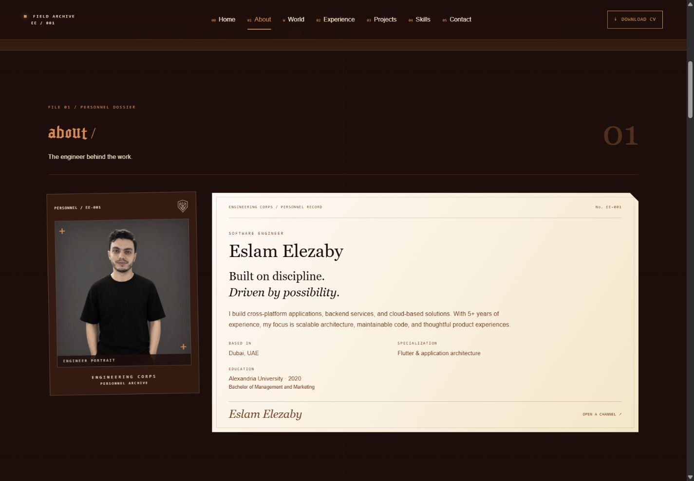
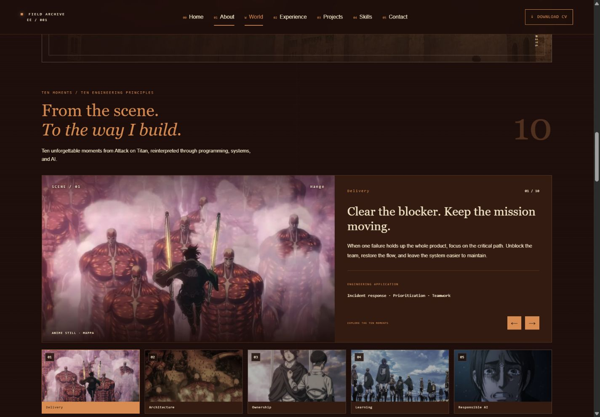

<div align="center">

# Eslam Elezaby
### The Engineering Corps · Personal Portfolio

A cinematic engineering archive that brings software, systems, and AI into an Attack on Titan–inspired world.


[GitHub](https://github.com/eslamelezaby1/portfolio) · [LinkedIn](https://www.linkedin.com/in/eslamelezaby98/) · [Email](mailto:eslamelezaby1@gmail.com)

</div>


## Overview

The personal portfolio of **Eslam Elezaby**, a Dubai-based software engineer with 5+ years of experience in cross-platform applications, backend services, and AI/ML integrations.

The interface takes the form of a field archive: a personnel dossier, service records, mission files, and an equipment inventory. Anime imagery establishes the atmosphere; original engineering messages connect it to programming, application architecture, and useful AI.

## Highlights

- **Cinematic identity:** locally hosted Gothic display typography, original insignia, and a copper-led palette.
- **Professional dossier:** real portrait, specialization, education, and CV-based career details.
- **Service timeline:** experience at SSGIT, Stoork, and ECMPP, with responsibilities and technologies.
- **Mission files:** expandable records of documented professional work.
- **Ten-moment gallery:** selectable anime scenes paired with original programming and AI interpretations; previous/next controls and mobile-friendly navigation.
- **Interactive architecture:** explore the Interface, Services, and Intelligence layers.
- **Direct connections:** GitHub, LinkedIn, email, WhatsApp, and a downloadable PDF CV.
- **Responsive and accessible:** fixed section navigation, semantic HTML, keyboard focus states, reduced-motion support, and optimized images.

## Screenshots

| Personnel dossier | Engineering moments |
| --- | --- |
|  |  |

<details>
<summary><strong>Mobile preview · 390px</strong></summary>

<br />


</details>

Screenshots show the local production build at 1440 × 1000 and 390 × 844. Images are stored in the repository so they render directly on GitHub.

## Technology

| Area | Implementation |
| --- | --- |
| Framework | Next.js 16 · App Router |
| Interface | React 19 · TypeScript |
| Styling | Tailwind CSS 4 · custom responsive CSS |
| Assets | `next/image` · `next/font/local` · inline SVG |
| Server functionality | Node.js route handler for the CV download |
| Deployment | Compatible with Vercel or a Node.js host |

The current portfolio runs without API keys or environment variables. AI/LLM references describe engineering skills and interests; the site does not call an external AI service.

## Run locally

**Requirements:** Node.js 20.9 or newer and npm.

```bash
git clone https://github.com/eslamelezaby1/portfolio.git
cd portfolio
npm ci
npm run dev
```

Open [http://localhost:3000](http://localhost:3000). If that port is occupied, use the address printed in the terminal.

### Commands

| Command | Purpose |
| --- | --- |
| `npm run dev` | Start the local development server |
| `npm run lint` | Run ESLint |
| `npm run typecheck` | Check TypeScript types |
| `npm run build` | Create the production build |
| `npm start` | Serve an existing production build |

```bash
npm run build
npm start
```

## Project structure

```text
app/
  api/cv/route.ts             PDF download endpoint
  fonts/                     Local display font and its license
  globals.css                Theme, layouts, and responsive styling
  layout.tsx                 Metadata, document shell, and font setup
  page.tsx                   Portfolio sections
components/
  navigation.tsx             Fixed navigation and active section tracking
  dossier.tsx                Professional portrait record
  archive-art.tsx            Original insignia and SVG schematics
  anime-world.tsx             Cinematic engineering mindset section
  engineering-moments.tsx    Interactive ten-scene gallery
lib/
  portfolio.ts               Profile, experience, projects, and skills
  engineering-moments.ts     Gallery messages and engineering applications
public/
  assets/                    Artwork, icons, and scene stills
  Eslam-Elezaby-CV.pdf        Downloadable CV
  
docs/screenshots/            README preview images
```

## Customize

| Change | File |
| --- | --- |
| Profile, contact links, experience, and skills | `lib/portfolio.ts` |
| Gallery messages | `lib/engineering-moments.ts` |
| Page content and section order | `app/page.tsx` |
| Colors, spacing, typography, and breakpoints | `app/globals.css` |
| Browser title and description | `app/layout.tsx` |
| CV download | Replace `public/Eslam-Elezaby-CV.pdf` |
| README previews | Replace the images in `docs/screenshots/` |

The CV is served at `/api/cv` with a PDF content type and attachment filename. Project mission files describe professional employment work rather than invented standalone products.

### Color system

| Color | Hex | Role |
| --- | --- | --- |
| Copper | `#D88C51` | Primary identity, headings, buttons, and active controls |
| Dark brown | `#1D0E0B` | Page background and overlays |
| Rust | `#774023` | Supporting surfaces and borders |
| Cream | `#F3E7C9` | Secondary text and dossier paper |
| Ivory | `#FFF9F5` | Primary text and highlights |

The palette is based on [Loading.io’s Attack on Titan collection](https://loading.io/color/feature/AttackonTitan/). Transparent and mixed shades provide depth without changing the base palette.

## Deploy with Vercel

1. Push the project to GitHub.
2. Import the repository into [Vercel](https://vercel.com/new).
3. Keep the **Next.js** framework preset and the repository root directory.
4. Use the default build command, `npm run build`, and leave the output directory at its framework default.
5. Deploy. Connected Git pushes can then trigger updated deployments.

See [Vercel’s Git deployment guide](https://vercel.com/docs/git). The project uses a server route and image optimization, so it is intended for a Next.js-capable host rather than an unchanged GitHub Pages static export.

## Credits and asset usage

- **Portfolio content and identity:** Eslam Elezaby.
- **Attack on Titan:** created by Hajime Isayama. This is an unofficial personal portfolio; anime characters and imagery belong to their respective owners.
- **Scene stills:** credited to MAPPA, selected from [constancejb’s BuzzFeed article](https://www.buzzfeed.com/constancejb/10-unforgettable-moments-from-attack-on-titan). Engineering interpretations are original portfolio copy.
- **Artwork:** supplied portfolio assets and a generated Colossal Titan fan-art illustration. The illustration is not an official anime frame.
- **Display font:** [Goth Titan by Juan Casco](https://www.fontspace.com/goth-titan-font-f77855). Its included [license](app/fonts/LICENSE.md) permits personal use; commercial use requires permission from the designer. The supplied file lacks outlines for many capitals, so display titles use lowercase lettering.

No general open-source license is declared for this repository. Third-party art and fonts retain their own ownership and licensing terms.
